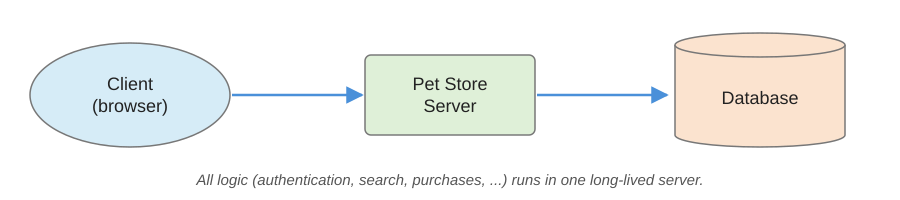
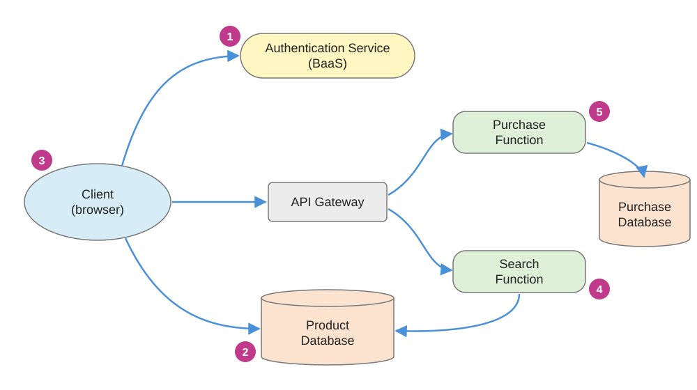
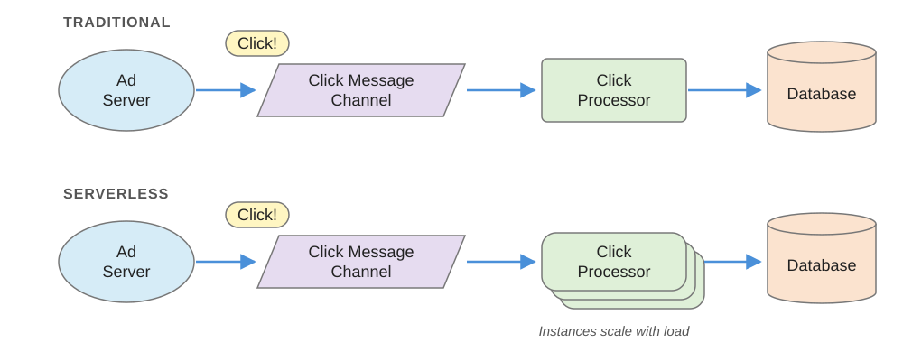

# Serverless (FaaS) vs. Containers: When to Pick Which?

## Why Should We Know?

* Serverless and containers let us build applications based on a microservices architecture.

## Recall: Microservices

> "A microservice is an independent and self-contained software component that runs in its own process and communicates with other microservices using lightweight protocols."

> "Microservices architecture is an architectural style in which the system is constructed from communicating microservices. It is well-suited to cloud based systems where each microservice can run in its own container."

From Sommerville (2020), Ch. 6.

## Recall: Containers

* Containers are an *operating system* virtualization technology: independent servers share a single operating system.
	* Usually megabytes in size, whereas virtual machines (VMs) are gigabytes.
	* Start and stop in seconds, rather than the minutes a VM needs.
* Docker: a *Dockerfile* defines an *image*, which packages the software and everything it depends on; a *container* is a running image.
* Kubernetes *orchestrates* containers: runs, replicates, and restarts them across many machines.
* You built a Docker image of your own project in *Containerize Your Project*.

Adapted from Sommerville (2020), Ch. 5, and [Müns (2017)][muns].

## What Is Serverless?

> "Serverless architectures are application designs that incorporate third-party 'Backend as a Service' (BaaS) services, and/or that include custom code run in managed, ephemeral containers on a 'Functions as a Service' (FaaS) platform."

From [Roberts (2018)][roberts].

## What Is Serverless? (cont.)

### Backend as a Service (BaaS)

* Applications that rely mostly or entirely on third-party, cloud-hosted services for server-side logic and state.
* E.g., cloud-accessible databases (Firebase, Supabase) and authentication services (Auth0, Amazon Cognito).

### Functions as a Service (FaaS)

* The developer still writes the server-side logic, but it runs in compute containers that are:
	* Stateless.
	* Event-triggered.
	* Ephemeral: may last for only one invocation.
	* Fully managed by a third party.
* E.g., AWS Lambda (launched 2014), Azure Functions, Google Cloud Run functions, Cloudflare Workers, Vercel Functions.
	* Some run functions in lighter sandboxes than containers (e.g., Cloudflare Workers uses V8 isolates).

Adapted from [Roberts (2018)][roberts] and [Müns (2017)][muns].

## Serverless: Three Essential Qualities

1. An abstraction that hides the servers and the complexity of programming and operating them.
1. Pay-as-you-go pricing instead of reserved capacity: no charge for idle resources.
1. Automatic, rapid scaling up and down to match demand, from zero.

* Serverless is more than FaaS: e.g., object storage (Amazon S3) also hides its servers.
* Analogy: *serverful* computing is like renting a car (reserve it for your whole stay, drive and refuel it yourself); *serverless* is like taking a taxi (pay per ride; someone else drives).

From [Schleier-Smith et al. (2021)][cacm].

## Example of FaaS

* A typical e-commerce app: an online pet store with a traditional three-tier, client-oriented architecture.

{title="Adapted from Roberts (2018)."}

Example adapted from [Roberts (2018)][roberts].

## Example of FaaS (cont.)

* A serverless (FaaS) architecture may end up looking more like this:

{title="Adapted from Roberts (2018)."}

Example adapted from [Roberts (2018)][roberts].

## Example of FaaS (cont.)

* A different example is an online advertisement system:

{title="Adapted from Roberts (2018)."}

Example adapted from [Roberts (2018)][roberts].

## Features of FaaS

* Run backend code without managing your own servers *or* your own long-lived server applications.
* Functions are triggered by event types that the provider defines (e.g., HTTP requests, file uploads, schedules, queue messages).
* Upload the function's code; the provider does the rest (provisioning, running, and scaling it).
* The whole application's business logic is implemented as *functions* and *events*.

Adapted from [Roberts (2018)][roberts] and [Müns (2017)][muns].

## Comparing FaaS with Containers

:::::::::::::: {.columns}
::: {.column width="50%"}

* Advantages of serverless
	* Zero administration
	* Significantly reduced administration and maintenance burden
	* Faster time to market
	* Auto-scaling
	* Pay-per-execution
	* Zero cost for idle time

:::
::: {.column width="50%"}

* Disadvantages of serverless
	* No standardization
	* Vendor lock-in
	* "Black box" environment
	* Cold starts

:::
::::::::::::::

From [Müns (2017)][muns].

## Comparing FaaS with Containers (cont.)

:::::::::::::: {.columns}
::: {.column width="50%"}

* Advantages of containers
	* Control and flexibility
	* Easier migration path
	* Portability

:::
::: {.column width="50%"}

* Disadvantages of containers
	* Administrative work
	* More manual intervention
	* Scaling is slower
	* Hard to get started

:::
::::::::::::::

From [Müns (2017)][muns].

## When to Pick Which

1. Costs
1. Portability
1. Convenience

## References

1. Sommerville, I. (2020). *Engineering Software Products: An Introduction to Modern Software Engineering*. Pearson.
1. Roberts, M. (2018). [Serverless Architectures][roberts]. martinfowler.com.
1. Schleier-Smith, J., Sreekanti, V., Khandelwal, A., Carreira, J., Yadwadkar, N. J., Popa, R. A., Gonzalez, J. E., Stoica, I., & Patterson, D. A. (2021). [What Serverless Computing Is and Should Become: The Next Phase of Cloud Computing][cacm]. *Communications of the ACM*, 64(5), 76–84.
1. Müns, P. (2017). [Serverless (FaaS) vs. Containers—When to Pick Which?][muns] Serverless, Inc.

[svc]: https://s3.amazonaws.com/files.commons.gc.cuny.edu/wp-content/blogs.dir/2880/files/2021/05/Serverless_vs_containers.pdf
[roberts]: https://martinfowler.com/articles/serverless.html
[muns]: https://www.serverless.com/blog/serverless-faas-vs-containers
[cacm]: https://doi.org/10.1145/3406011
